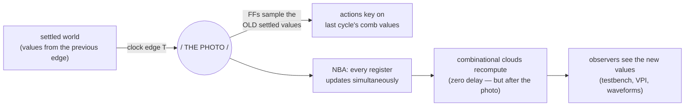
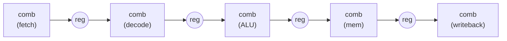

# The Photograph Model

*Clock edges, combinational lies, interface contracts — and why pipelines are made of delay.*

Distilled from the 2026-10-19/20 debugging session on `i2c_bit_prim`, in which a
"cocotb 2.1 migration" turned into a guided tour of every layer of synchronous
design — and ended in a three-line RTL fix.

---

## 1. Two axes that get tangled

Beginners (and docs) blur two independent distinctions. Sort them once and
half the confusion dies:

| Axis | Question | Values |
|------|----------|--------|
| Memory | does it hold state? | **combinational** (no) vs **registered** (yes) |
| Trigger | what wakes it up? | **synchronous** (clock edge) vs **asynchronous** (event, e.g. `negedge rst_n`) |

Your instinct that "combinational logic is asynchronous" is *correct* — with
respect to the clock, it doesn't wait for anything. That property is exactly
what bites when it meets a flip-flop.

## 2. The photograph model

Every clock edge is a photographer taking one picture of the whole design:



Three beats: **photo → development → mirrors update**. Combinational logic
has zero delay — but *zero delay after the snapshot* is still too late for
that snapshot.

> **Rule 1.** A flop gating on a combinational condition effectively evaluates
> it on the *previous cycle's settled values*. A post-edge observer and the
> flop itself may disagree about that condition — by one clock.

## 3. The one-clock skew: a real bug

`i2c_bit_prim` (commit ea2b3ae) ended its bit operation like this:

```systemverilog
assign done = (st_q == ST_RAISE_HIGH) && scl_high_ok && tick;
...
always_ff @(posedge clk or negedge rst_n) begin
    ...
    if (done) rx_bit <= sda_sync;   // "sample when done"
end
```

`tick` is a *registered* pulse from `tick_div`. Trace what happens at the
critical edge (measured with per-edge DUT-state dumps from cocotb — time in
ns, one clock per 10 ns):

```mermaid
gantt
    title The one-clock skew (ns)
    dateFormat X
    axisFormat %s ns
    section tick (registered)
    low          :done0, 100, 135
    high         :done1, 135, 160
    section done — observer view
    low          :done2, 100, 135
    pulse        :crit, done3, 135, 145
    section done — FF-sampled view
    low          :done4, 100, 145
    acts         :done5, 145, 160
    section rx_bit
    stale        :done6, 100, 145
    latched      :done7, 145, 160
```



Read the two middle rows against each other: at t=135 the **observer's**
`done` (rebuilt combinationally from `tick`'s just-landed NBA value) pulses
high — while the **FF's** `done` (photographed from `tick`'s settled value)
is still low. The flop acts at t=145, which is exactly when `rx_bit`
latches. The pulse *looks* high one cycle before it *does* anything — and
the two `done` rows are the same signal.

Symptoms this produced before it was understood: a test reading `rx_bit`
right after `done` got the **previous operation's** value; the standalone SV
testbench hung forever on `wait(done)` + stale sequencing; the cocotb suite
appeared to behave differently across tool versions. None of it was the
framework. One clock of skew, wearing five disguises.

## 4. Event vs publication — the second trap

The obvious fix — register `done` — has a trap of its own:

```systemverilog
logic done_q;
always_ff @(posedge clk or negedge rst_n)
    if (!rst_n) done_q <= 1'b0;
    else        done_q <= (st_q == ST_RAISE_HIGH) && scl_high_ok && tick;
assign done = done_q;
```

…while leaving `if (done) rx_bit <= ...` unchanged. Result (observed): `done`
falls on the very edge `rx_bit` finally updates. The register *is* the pulse
now, and the latch keys on the register — one more edge of skew, in the other
direction. The completed fix names the **event** once and uses it for both:

```systemverilog
logic sample_now;
assign sample_now = (st_q == ST_RAISE_HIGH) && scl_high_ok && tick;

always_ff @(posedge clk or negedge rst_n)
    if (!rst_n) done_q <= 1'b0;
    else        done_q <= sample_now;        // publication
...
    if (sample_now) rx_bit <= sda_sync;      // the action, same condition
```

Now one NBA batch does everything — `rx_bit` latches, `done_q` sets,
`st_q` moves — and any observer waking at that edge reads `done=1` *and* the
fresh `rx_bit` in the same photograph. Simultaneity by construction.

> **Rule 2.** A registered pulse is the **publication** of an event, not the
> event. Actions that happen *at* the edge key on the condition; never gate an
> event's action on its own registered mirror.

## 5. Test wrong, or RTL wrong?

When a test and a design disagree, ask: **which one holds the spec?** Here the
RTL's own port comment promised it (`done` — "1-cycle pulse (bit completed)";
`rx_bit` — "sampled SDA during SCL high"): when you see `done`, the data is
there. The implementation broke that promise as an *accident* of comb-vs-
registered composition — not a decision. The test did what any honest
consumer does: read the data when the handshake fired.

Fixing the test instead (wait one extra cycle) would convert an accident into
a contract — and the next consumer would inherit the confusion. Interfaces
where data arrives *after* the "data ready" flag are contradictions; implicit
extra rules rot.

| signal | meaning | consumer rule |
|---|---|---|
| `done` | "the bit is sampled, `rx_bit` valid — this edge" | read `rx_bit` immediately |
| `busy` falling | "FINISH_LOW walked, bus is free" | safe to kick the next op |

Two handshake truths, both fine — the bug was `done` sitting ambiguously
between them.

## 6. "So we always delay things?" — how fast designs work

The register isn't a delay. It's the **unit of account**: synchronous design
measures time in cycles, and the question is never "how do I avoid the
cycle?" but "what happens *this* cycle vs *next*?"



- **Parallelism within a cycle** is combinational logic — the adder, shifter,
  and comparator all compute *during* the cycle and are photographed at the
  same edge. Thousands of clouds, one snapshot.
- **Registers between stages** make overlap *safe*: each stage works on a
  stable snapshot of the previous stage's output — the photograph model,
  industrialized.
- The pearl: a pipeline makes each instruction **slower** (5 cycles of
  latency) while the machine gets **faster** (one instruction completes every
  cycle). *Latency ≠ throughput.* The "delay" is the mechanism of the
  parallelism.

When you genuinely cannot wait a cycle, RTL has answers:

1. **Combinational paths** — same-cycle signals flow through logic with no
   register (`busy = (st_q != ST_IDLE)` is unregistered *because* it is
   meant to be same-cycle).
2. **Forwarding / bypass** — the CPU answer to "result needed now,
   writeback two cycles away": mux clouds route the just-computed value to
   the next consumer. You buy back the register delay with combinational
   wiring and more control logic.
3. **Scheduling** — know data arrives at cycle N+1 and arrange the consumer
   to use it at N+1. That is what a pipeline schedule *is*.

In this vocabulary, the `done`/`rx_bit` bug was a **stage-alignment error** —
control and data offset by one cycle, i.e. a hazard (think load-use). We
fixed it by alignment (register the event, one NBA batch) rather than by
forwarding (comb `done`, consumers wait) — both legitimate; alignment was
simpler and matched the documented intent.

So: parallelism isn't defeated by the register — it is **organized** by it.
The register is not a tax on computation; it is the fence that lets a
thousand computations run in the same cycle without reading each other's
half-finished thoughts.

## 7. Why the rigidity wins

- `fmax = 1 / (slowest combinational path + setup)` — one number, found by
  static timing analysis. Too slow? Cut the long cloud with a register:
  trade one cycle of latency for a higher clock. That trade is the entire
  art of high-speed RTL.
- Every register sees every other register's previous-edge value: no races,
  no analog surprises — and formal proofs (SBY) only *exist* because of this
  discipline.

And the cost in context: registering `done` added one `clk` to an operation
paced by `tick` — thousands of clocks at real I²C speed. When your sequencing
is paced by something much slower than your clock, the one-cycle price of an
honest interface is free.

## 8. Sense of proportion — for the programmer arriving in RTL

Coming from software, where a nanosecond is effectively free and an
abstraction layer costs only memory, RTL quietly inverts your instincts.
The judgments that feel like discoveries at first:

- **A cycle is a budget line, not a rounding error.** In software you rarely
  count the cost of a function call; in RTL every register crossing appears
  on the schedule, visible in the waveform and in the cycle count. You don't
  ask "is there a delay?" — you ask "which cycle does this land in?"
- **…but cost is always relative to the pacing clock.** The one `clk` that
  registering `done` added is thousands of times smaller than the `tick`
  that paces an I²C bit. Nobody will ever measure it. "Free" and
  "expensive" are not properties of a delay — they are *ratios* between a
  delay and the slowest clock in the story. One cycle in a 322 MHz Ethernet
  MAC path matters enormously; one cycle behind a 100 kHz I²C bus is noise.
  Registering an output to make an interface honest is almost always the
  cheap side of that ratio.
- **Determinism beats cleverness.** In software, faster-but-fragile
  sometimes wins the argument. In RTL the entire verification stack — your
  SBY proofs, static timing analysis, the photograph model itself — exists
  *because* every register sees the last-edge world. Spending a cycle to
  keep that contract is usually the cheapest correctness you will ever buy.

A small translation table that keeps helping:

| software intuition | RTL counterpart |
|---|---|
| function-call overhead | a pipeline stage — one cycle, on the schedule |
| cache-miss stall | waiting on a slow resource (our `tick`, a memory) |
| branch predictor + forwarding | bypass network around a register |
| interface contract in a docstring | port comment + registered handshake |
| "premature optimization" warning | unregistered same-cycle paths that create hazards |

## 9. Takeaways for this repo

1. Name the event; key actions on the condition; publish via a register.
2. Outputs that mean "X just happened" get registered — event and evidence
   visible on the same edge, by construction.
3. Tests may assume exactly what the port comments promise; when they
   disagree with the RTL, the port comment decides who's wrong.
4. A test suite's results are a property of tests + framework + shared
   state — isolate (COCOTB_TEST_FILTER), dump DUT state per edge
   (`--public-flat-rw` exposes internals to cocotb), and never trust a
   version bump to be the variable.
5. The invariant that would have caught this in minutes — "rx_bit changes
   only at the sample point" — is exactly what `i2c_bit_prim_props` encodes.
   Keep the formal harness alive.

*Companion artifacts: the per-edge dump technique lives in the 2026-10-19
session notes (`.superpowers/sdd/`); the fix itself in the
`cocotb-2.1-migration` work on `rtl/i2c_bit_prim.sv`.*
